# Quote Quest

A random quote generator you play. Pick a world, steer the claw, grab a ball, and the quote inside steps out on a retro game card.

**Play it: [quote-quest-lyart.vercel.app](https://quote-quest-lyart.vercel.app)**

Day 2 of the 7-day build challenge. Next.js 16, React 19, Tailwind v4, 8bitcn components. The first take on day 2, Quote Casket, is still here at `/casket` and is described further down.

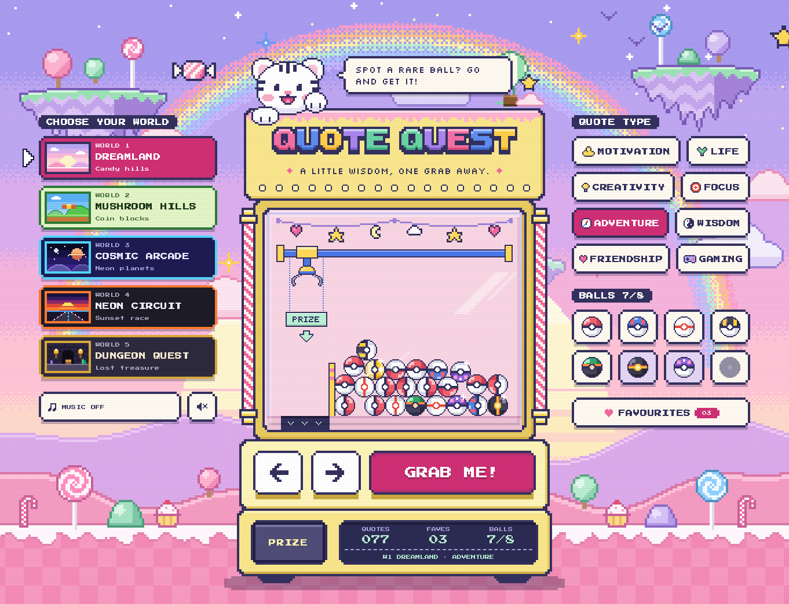

## Run it

```bash
pnpm install
pnpm dev
```

```bash
pnpm test
```

```bash
pnpm e2e
```

`pnpm test` runs 45 unit tests in about three seconds. `pnpm e2e` needs `pnpm dev` running: it drives a headless Chrome through every screen at 17 window sizes, plays two whole rounds with real key presses, clicks and touches, and samples the frame rate (767 checks, about four minutes).

To publish a new version (the folder is linked to the Vercel project `quote-quest`; `docs/` is left out of the upload by `.vercelignore`):

```bash
pnpm dlx vercel deploy --prod
```

| Route | What it is |
| --- | --- |
| `/` | Quote Quest, the playable machine |
| `/assets` | Every sprite, every mascot face, and the five downloadable card pictures |
| `/casket` | Quote Casket, the earlier claw-and-television version |

## How it plays

1. **Choose a world.** Five of them, down the left, each card in its own world's colours. The scenery, the cabinet, the music and the quote card all change with it.
2. **Choose a quote type.** Motivation, Life, Creativity, Focus, Adventure, Wisdom, Friendship or Gaming. It decides which quotes are in the machine.
3. **Move the claw.** Hold the arrow buttons, hold ← → (or A and D), or tap the glass and the claw slides to that spot. A dotted line shows where it will land, and the ball it would take gives a little hop.
4. **GRAB ME!** The claw drops, closes, lifts and carries the ball to the prize chute. It is a real pile with real physics, and aiming chooses which ball you get. But no grab comes up empty: press the button with nothing under the claw (it parks over the prize chute) and it slides to the nearest ball first, then drops. On the way down it follows the ball it is after, and if the pile shifts and the prongs close on nothing, it goes straight back for another.
5. **The reveal.** The ball rises into the middle of the glass, rays whirl around it, it cracks open. Always 2.3 seconds. The rays are the same ones that turn behind the quote card and sit behind it in the downloaded picture: one palette per rarity, eight even fans.
6. **The quote.** The card steps out in front of the machine, everything else dims, slow prize rays turn behind it, and the quote types itself. Underneath, in one row: previous, next, SAVE, DOWNLOAD and PLAY AGAIN.
7. **The book.** FAVOURITES opens the Quote Book: an open book, one quote to a spread, with bookmarks for saved quotes, recent quotes and the ball album.

Keys: ← → move the claw, Space or Enter grabs. With a quote showing, ← → leaf through the quotes you have revealed, Space skips the typing or plays again, Esc closes. In the book, ← → turn the page.

Everything fits one screen at any window size, and nothing scrolls. `src/quest/layout.ts` picks the arrangement, and it prefers one it can draw at exactly full size over a richer one it would have to shrink, because the art is on a 4px grid and only whole scales draw every pixel the same size.

| Arrangement | When | What it looks like |
| --- | --- | --- |
| Beside | Wide windows | Worlds down the left, quote types and the ball collection down the right. On a shorter window the cabinet's base slims, then its banner, then the base goes and its three counters move under the right-hand menu. |
| Split | Short, wide windows (most laptops, a phone on its side) | The cabinet loses its ledge and base; the arrows, GRAB ME! and the world and type buttons stand on a deck beside the glass. |
| Folded | Tall, narrow windows (phones, tablets upright) | The menus fold into a bar across the top, drawn at full size whatever the cabinet's scale: the world you are in with its picture, the quote type, a heart with the number saved, and one audio button. |

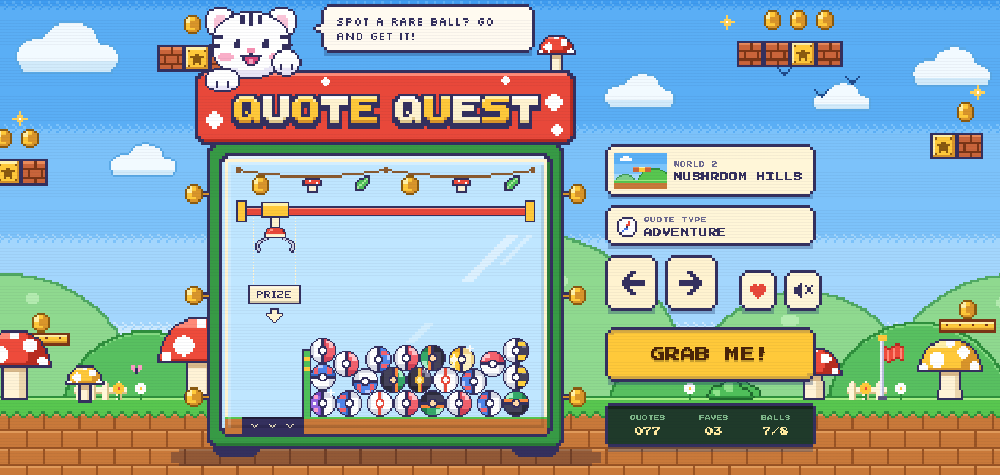

| | |
| --- | --- |
| 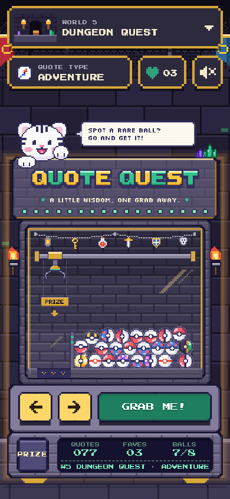 | 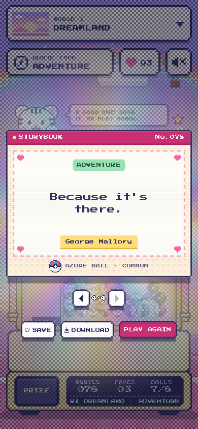 |

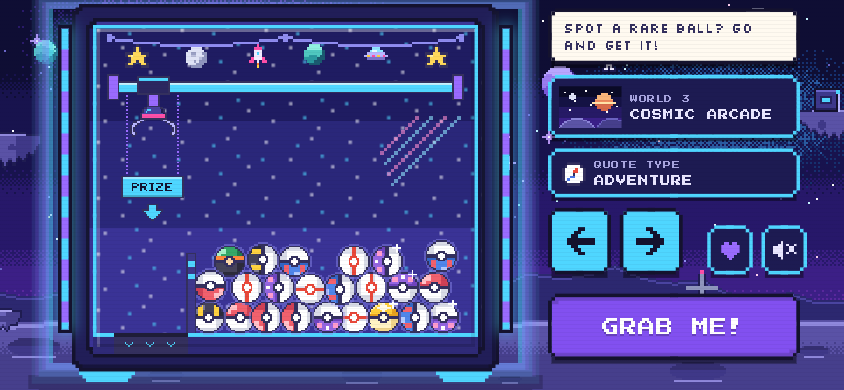

Where the game has to be drawn smaller, small print is set larger by the same amount, so no text is ever under 8px on the screen, and a quote on a phone is set at 16px. The bar's buttons open a level-select screen: a dark field of pixel stars, the heading and the DONE button on the centre line, and a card per world between them, five across, three and two, or two, two and one.

## Five worlds

| | World | Scenery | Cabinet | Quote card | Tune |
| --- | --- | --- | --- | --- | --- |
| 1 | Dreamland | Lavender-to-peach sky, a rainbow, floating islands, candy hills, an iced floor | Pastel yellow, a barber pole turning down each side, held top and bottom by the same gold cap | Storybook: dotted paper, dashed frame, hearts in the corners | Cotton Sky |
| 2 | Mushroom Hills | Blue sky, round green hills, brick rows with coins, giant mushrooms | Green body, a red mushroom-cap marquee, coins on the sides, brick base | Message block: brick title bar, white frame, coin-block name plate | Hop Along |
| 3 | Cosmic Arcade | Nebulae, a ringed planet, a galaxy, a rocket parked on the moon | Midnight blue with neon tubes and a glow | Transmission: grid, scanlines, signal bars | Starfield |
| 4 | Neon Circuit | A striped sunset, a city skyline, a road running to the horizon, a car in each lane | Black with checkered strips and racing stripes | Results board: checkered strip, racing stripes | Night Lap |
| 5 | Dungeon Quest | Stone wall, torches, pillars, banners, barrels and a treasure chest | Carved stone with gold trim and a torch on each side | Parchment: foxed paper, a double rule in brown ink, a wax-red tag | Torchlight |

| | |
| --- | --- |
| 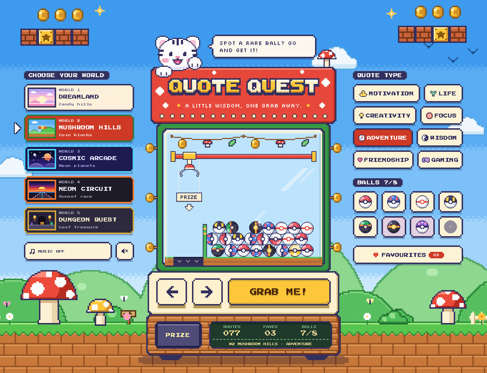 | 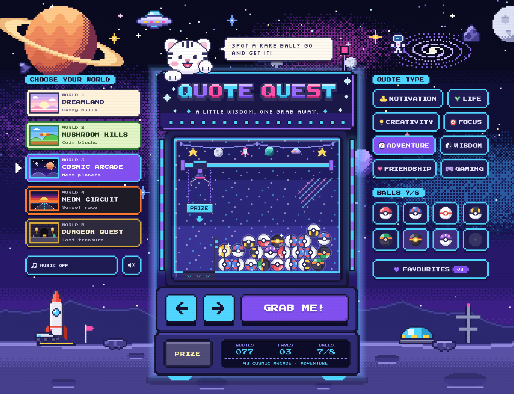 |
| 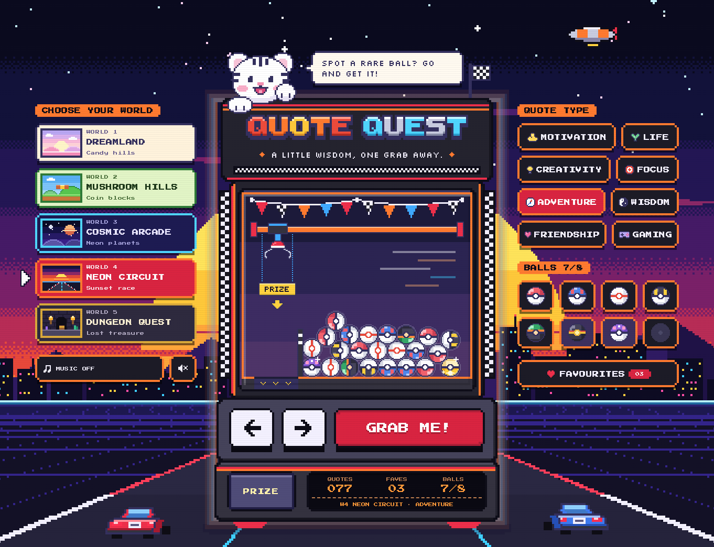 | 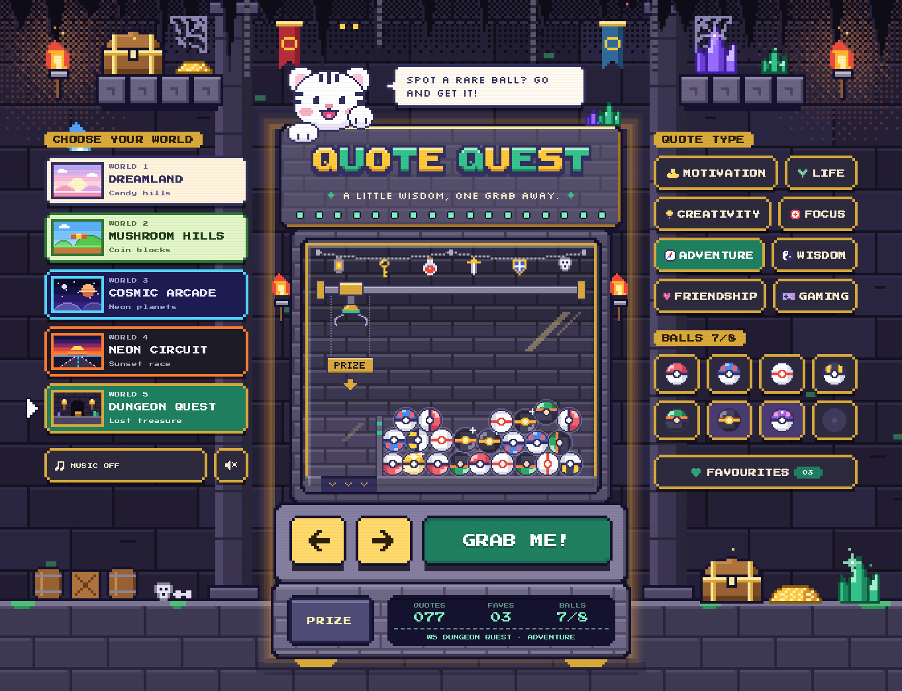 |

Every prop on a machine belongs to its world. Inside the top of the glass there is a garland, a line strung in two swags, and what hangs from it changes: hearts, stars, a moon and a cloud in Dreamland; coins, mushrooms and leaves in Mushroom Hills; a rocket, a saucer, a moon and a planet in Cosmic Arcade; race bunting in Neon Circuit; and an adventurer's kit on an iron chain in the dungeon (lantern, key, potion, sword, shield, skull). It is one sprite in two frames, so it jingles without a single rotated pixel.

The banner is laid out the same way on every machine: a clear band where the cub's paws hook over the edge, the name, the tagline on one line, then a row of lamps across the full width (a checkered strip of the same height in Neon Circuit), so the banner is the same size in every world. Behind that each has its own background: dripping icing in Dreamland, a spotted mushroom cap, three bands of night sky with stars kept to the margins, racing stripes, and stonework.

The glass catches the light differently in each world too: a broad soft shine in Dreamland, crisp bars in Mushroom Hills, thin neon lines in Cosmic Arcade, streaks of passing light in Neon Circuit, and torchlight pooling down each side in the dungeon. All of it sits in the open middle of the pane, clear of the garland, the rail and the sign. The PRIZE sign hangs from the rail on two chains, its letters drawn pixel by pixel, over a chute marked with chevrons.

Each world is a stack of painted layers on a 512 by 270 pixel stage, pinned to the bottom of the screen and drawn at a whole number of screen pixels per art pixel. A wide, short window hides the top rows of that stage, so everything above a seam (the coin blocks, the planets, the islands, the whole dungeon ceiling) hangs from the top of the window instead and slides down by however many rows are hidden: nothing in the sky is ever sliced by the window's edge. And it moves. Far layers scroll past one art pixel at a time (each is painted twice, side by side, so it never jumps); the floor stays put, so the machine stands still while the world goes by. On top of that each world has its own cast:

| World | What moves |
| --- | --- |
| Dreamland | Far hills and islands scrolling, clouds, two hot-air balloons, a flock of birds, floating islands and cake platforms bobbing, two wrapped sweets, a shooting star. A rainbow arches over the machine; cupcakes, candy canes and lollipops stand on the icing. |
| Mushroom Hills | Far hills scrolling, clouds, birds, one blob out for a walk, butterflies over the flowers, lifts riding up and down with a coin aboard, a goal flag in the wind, spinning coins. A signpost and picket fences on the grass. |
| Cosmic Arcade | A starfield and the planets drifting at two speeds, two asteroids tumbling past in quarter turns, an astronaut, a satellite, a patrolling saucer, a rover crossing the surface, and a rocket that waits on its pad, shudders and launches every 15 seconds. A moon base and a planted flag. |
| Neon Circuit | The road as a four-frame flip-book running toward you, and everything beside it rushing out from the vanishing point and past: lamp posts, palms, a hoarding, a marshal's flag, cones and tyre stacks. Nothing at the trackside stands still. Three cars drift in their lanes; a blimp crosses the sky. |
| Dungeon Quest | Water dripping from the roof, a spider on its thread, eyes blinking in the dark, a will-o'-the-wisp, a bat, a rat on the flagstones, torches. Barrels, a crate, bones, a chest and gold on the floor; banners and cobwebs up by the roof. |

Motion is kept to things that would move. On the machine that is the lamps, the cub, the claw, the balls, Dreamland's barber poles (the stripes climb a pixel at a time) and the name on the banner, where every few seconds a wave runs through the letters and then rests. The garland, the ornaments and the big button hold still.

The layers also slide a little against the pointer, the far ones least.

Changing world plays a wipe, and each world has its own, drawn on a 160 by 90 canvas and scaled up: banks of cloud roll in from the sides for Dreamland, a sky-blue iris closes to a point for Mushroom Hills, the screen dissolves to space behind stretching star streaks for Cosmic Arcade, a checkered flag sweeps corner to corner for Neon Circuit, and a stone portcullis drops for Dungeon Quest. It is unhurried: about a second to close, 1.7 seconds covered, a second to open.

While the screen is covered a stage card shows: a picture of the world, its name at 24px, a line about it, which of the five it is, and the name of its tune. The card is that world's own quote card (storybook, message block, transmission, results board, parchment) standing on a dark plate with a white edge, so it reads against any of the wipes. Pick another world while one is arriving and it cuts straight to the new card.

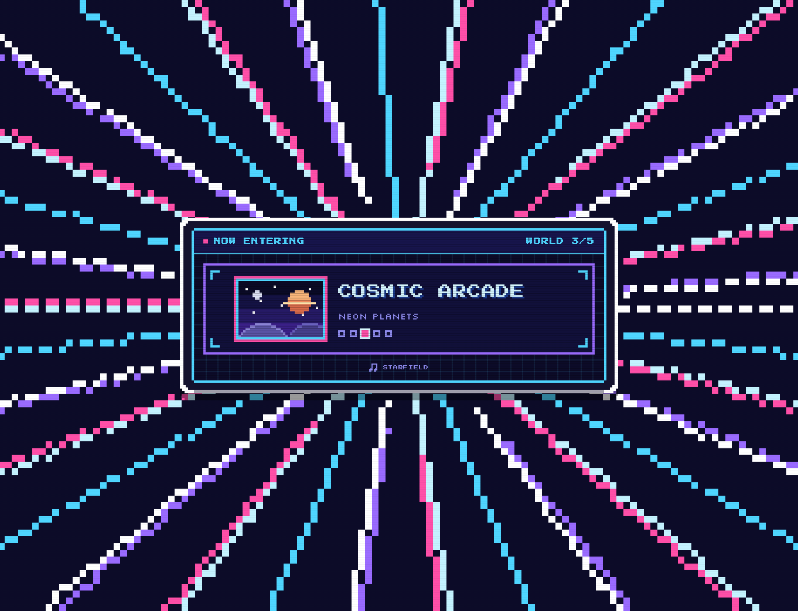

## The quote, on stage

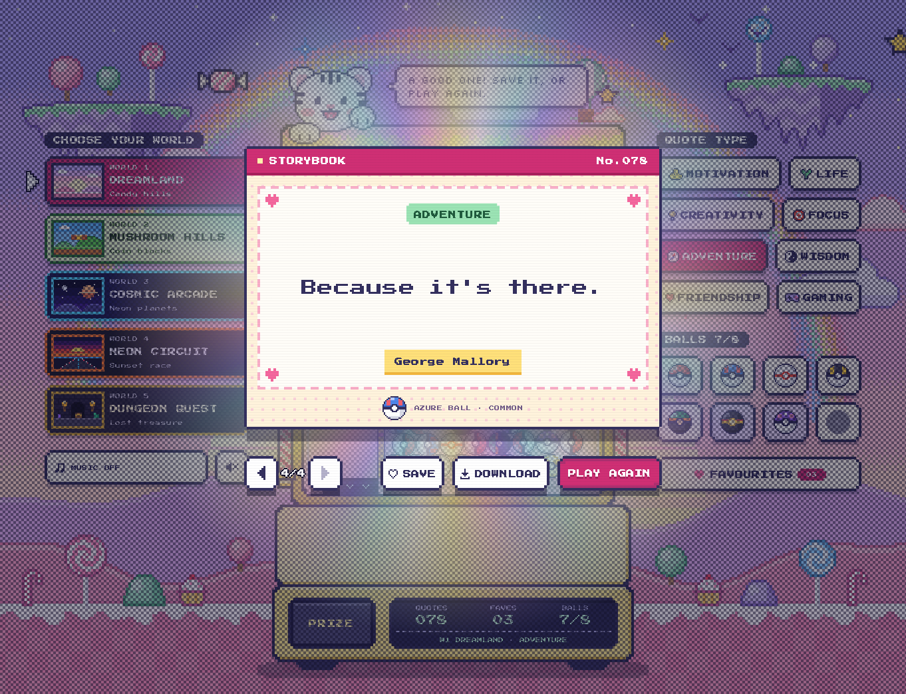

| | |
| --- | --- |
| 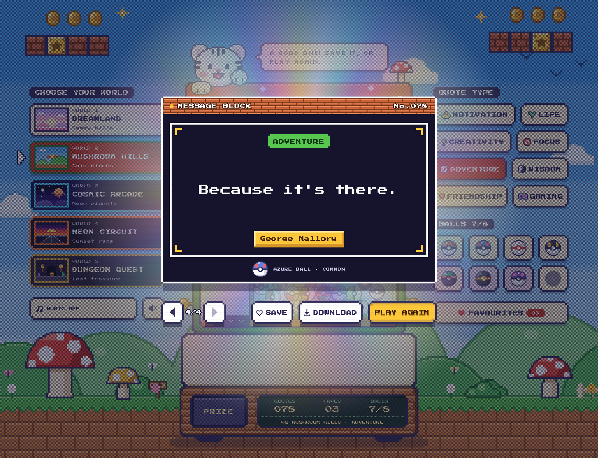 | 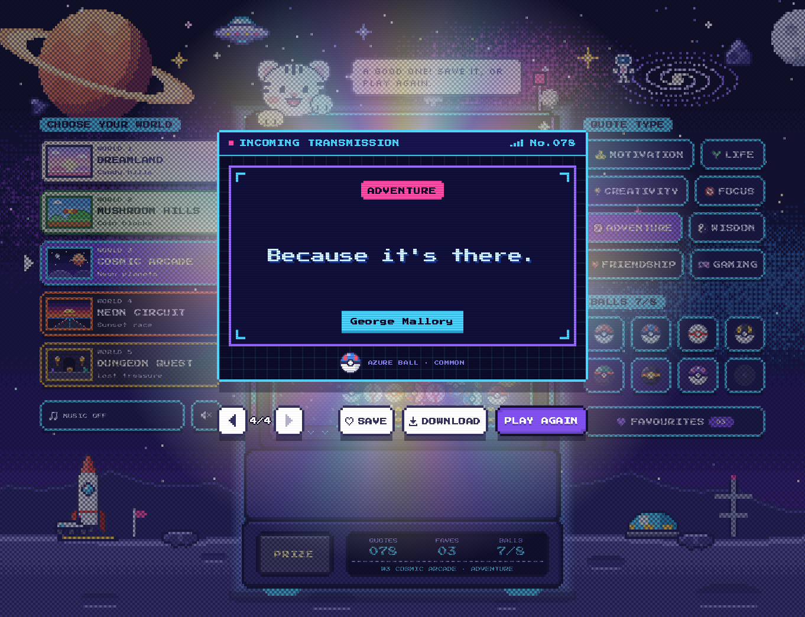 |
| 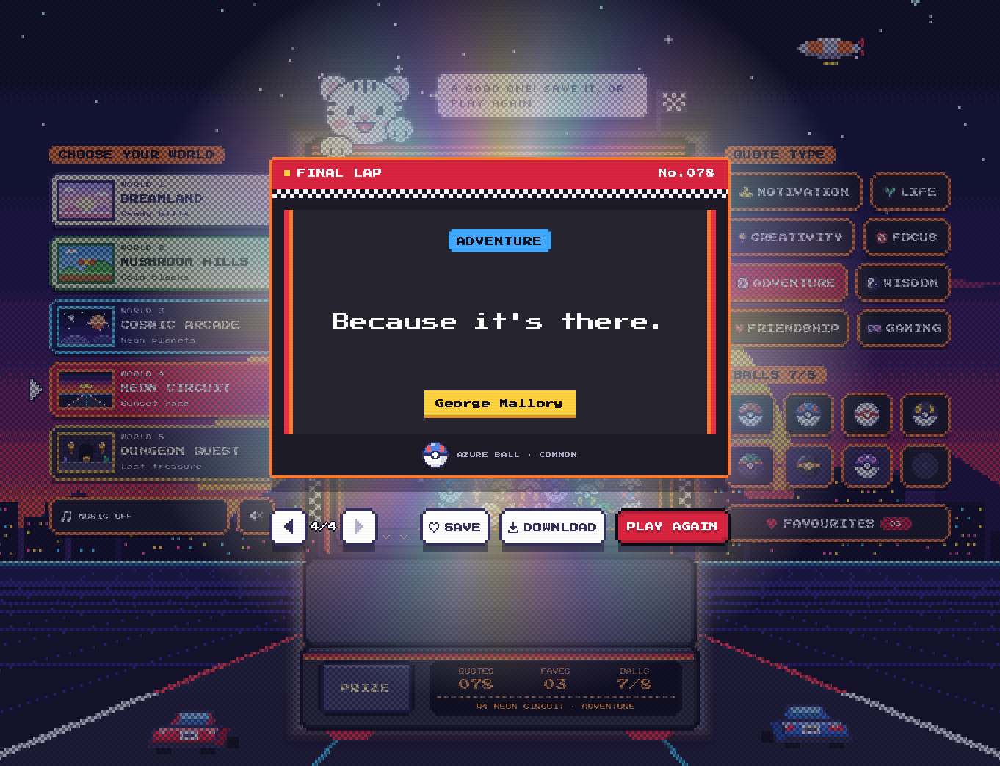 | 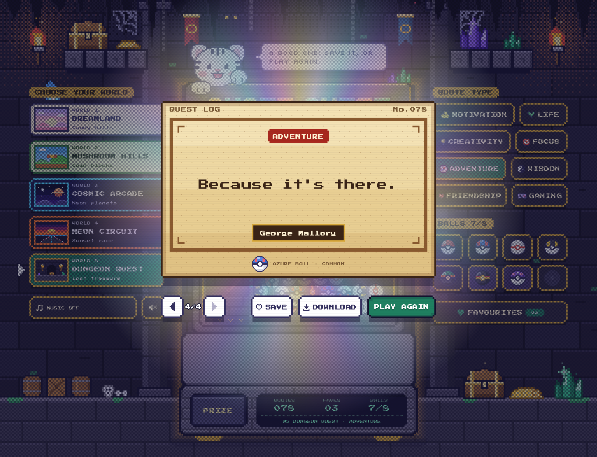 |

Every card has the same parts: a title bar with the quote's number, a framed panel with a bracket in each corner, the category tag, the quote in the arcade face, a name plate for whoever said it, and a footer naming the ball and its rarity. Every edge is hard: no blur, no glow, no rounded corners.

DOWNLOAD saves the quote as a 1200 by 1000 PNG. The card in the picture is drawn from the same measurements and the same per-world trims as the card on screen (dashed frame and hearts, brick title bar, grid and scanlines, checkered strip, gold frame), with the rays behind it and the cub hooked over the top edge pulling that world's face (heart eyes in Dreamland, a wave in Mushroom Hills, star eyes in Cosmic Arcade, shades in Neon Circuit, a wink in Dungeon Quest; star eyes anywhere for a legendary ball). `/assets` shows all five pictures without downloading anything.

## The Quote Book

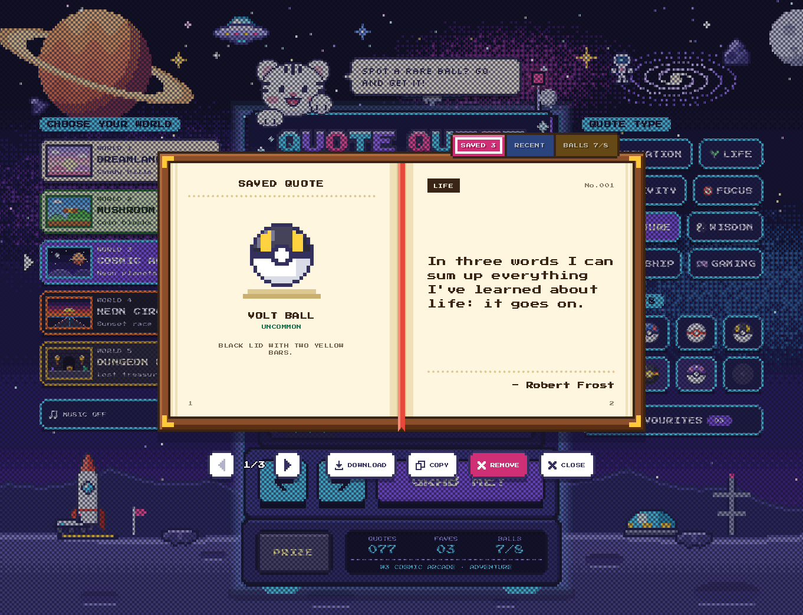

A leather cover with gold corners, two cream pages, a gutter down the spine with a ribbon in it. The left page shows the ball the quote came out of, on a little stand; the right page shows the quote. Tabs along the top (8bitcn's own) switch between SAVED, RECENT and BALLS, and the page swings over the spine in six hard steps when you turn it. The row underneath downloads, copies, or removes the quote on the page. On a narrow screen the book shows one page.

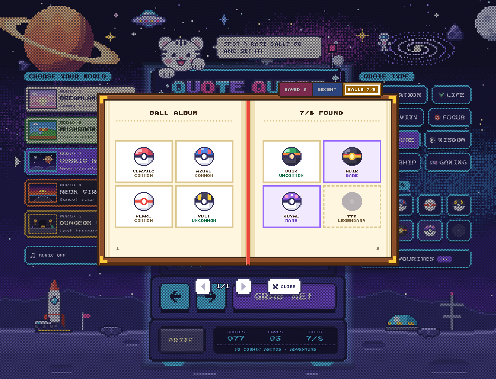

In a short window the book keeps both pages and gives up air instead, down to a 667 by 375 phone on its side.

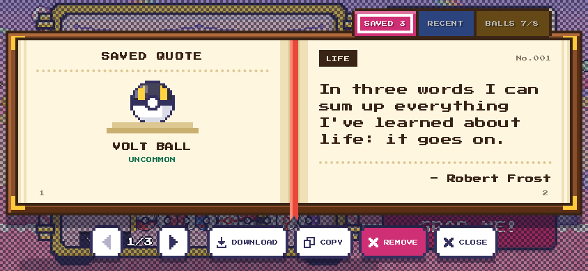

## Eight balls

Classic, Azure and Pearl are common; Volt and Dusk uncommon; Noir and Royal rare; Legend legendary. A full pile always hides exactly one Legend. Rarity only changes how loudly the reveal celebrates: every ball holds one quote. The ones you have found fill in on the right, and in the Quote Book.

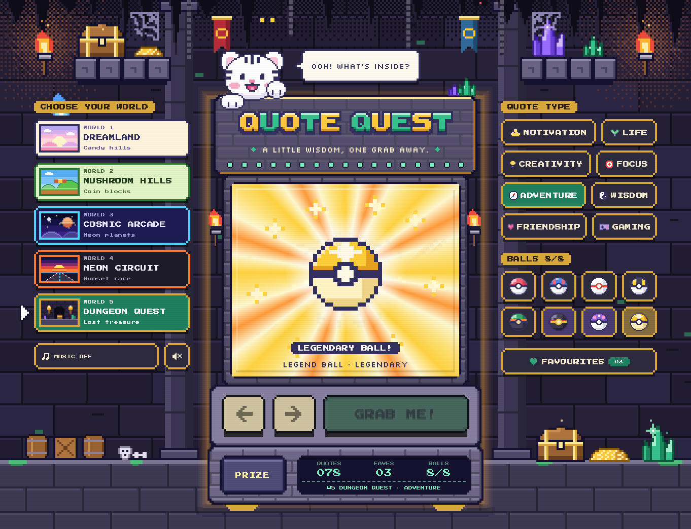

## The cub

It is never still. Left alone it runs through a routine, one act every couple of seconds: kneading the edge of the cabinet with its paws, looking left and right, flicking an ear, tilting its head with a wink, waving, and ducking behind the marquee to pop back up laughing. On top of that it breathes, blinks, leans to watch the claw, nods along when the music is on, and dozes off after 45 seconds alone. It has thirteen faces and six poses (heart eyes when you save a quote, star eyes for a rare ball, a sad shake on a miss), and poking it cycles through six of them.

## Music and sound

Each world has its own looping chiptune, written as note lists in `src/quest/music.ts` and played through a few oscillators. Nothing is sampled and nothing is borrowed. The tune starts after your first tap and then does not stop on its own: not in a background tab, not between quotes. Changing world changes the tune. It has its own switch under the world list; the speaker button mutes everything.

## How it is built

| File | What it holds |
| --- | --- |
| `src/quest/game.tsx` | The state: phases, save, world wipe, the quote on stage |
| `src/quest/layout.ts` | Which arrangement a window gets and at what scale. Plain arithmetic, unit-tested |
| `src/quest/claw.ts` | The machine itself: the pile, the claw, and each of its sixty steps a second. Nothing of the screen in it, unit-tested |
| `src/quest/machine.tsx` | Draws the machine, turns keys, taps and buttons into input for it, and gives its events their sounds |
| `src/quest/cabinet.tsx` | Marquee, ornaments, garland, prize reveal, quote showcase, controls, base |
| `src/quest/mascot.tsx` | The cub and its behaviour |
| `src/quest/panels.tsx` | World selector, quote types, ball collection, the Quote Book |
| `src/quest/scenery.tsx`, `scenery-art.ts` | The five painted worlds, their scrolling layers and moving casts, and the sprites they are built from |
| `src/quest/transition.tsx` | The five world-change wipes |
| `src/quest/worlds.ts`, `balls.tsx`, `cards.ts`, `quotes.ts`, `music.ts` | Data: worlds, ball designs, card styles, 56 quotes, five tunes |
| `src/quest/save.ts` | One localStorage entry: favourites, counts, world, type, balls found, the last 40 quotes |
| `src/quest/quest.css` | Every style, one `[data-world]` block per cabinet skin |
| `tests/` | Unit tests: layout, the claw, quotes, balls, worlds, tunes, the save |
| `scripts/qa/` | The end-to-end check: a small Chrome DevTools driver, the measurements it takes in the page, and the run itself |

Every control is an 8bitcn component: buttons, badges, cards, the speech bubble, dialogs and the book's tabs, recoloured through CSS variables. The end-to-end check fails if it finds a plain `<button>` or a frame of the wrong thickness. 8bitcn draws its pixel frames 6px thick; here one variable (`--bit`, added to the kit's components) sets them to 4px, the size of every other pixel in the game. Labels, numbers and titles are in Press Start 2P, 8bitcn's retro font. It is drawn on an 8 by 8 grid, so it is only set at 8, 12, 16, 20 or 24px, and the whole layout is scaled in whole eighths (never above 1.25): at those sizes its pixels land on whole screen pixels, where 9, 10 or 11px left some strokes two pixels wide and others one. Sentences (what the cub says, the line under the name) are in Silkscreen at 16px, a narrower bitmap face, so a whole sentence fits on one line. Nothing is bold. A faint scanline and a slight fall-off at the corners sit over the whole screen. All art is drawn in code; there are no image files and no remote assets.

The 56 quotes are real lines from real people (and seven from real games), seven per type. Adding one is a line in `quotes.ts`.

## Audit and scorecard

Last audited on 11 October 2026. This round was about one question: would it hold up as a released game? The method was to stop checking by eye and build a harness that measures, then fix what it found.

**What this round found, and what happened to it**

| Finding | Fixed? |
| --- | --- |
| A grab could come up empty. The claw parks over the prize chute, so pressing GRAB ME! twice in a row without steering dropped it on nothing | Yes. It now goes to the nearest place a drop would catch a ball. A unit test makes 150 unsteered grabs in a row and every one wins. |
| About one aimed grab in 400 still missed, because the ball it set off for shifted before the prongs closed (found when a test failed one run in six) | Yes. The claw follows its ball down, closes on whatever is really in its grasp, and goes again by itself if that is nothing. 8,160 grabs on freshly poured piles: no misses. |
| Sky props were sliced by the top of the window in wide, short windows (coins in Mushroom Hills, planets, the dungeon's chest) | Yes. The top of each scene hangs from the window's edge. Checked in five worlds at five sizes. |
| In small windows some text fell under 8px on screen (5.4px for the card's footer on a phone) | Yes. Small print grows as the canvas shrinks. Nothing is under 8px at any of 14 sizes. |
| The Quote Book did not fit a phone held sideways: every button was off the screen | Yes, down to 667 by 375. Smaller than that it scrolls. |
| On a real phone the book's BALLS page was 900px tall, taller than the screen, so the tabs and CLOSE were out of reach and there was no way out of the book. Found by Kruthin on an iPhone after the first deploy; the check had only ever opened the SAVED tab on phone sizes, and at sizes without the browser's toolbars | Yes. On a phone the book is never taller than the visible screen (the album is two rows of four, pages scroll inside the cover if they must) and there is a second close button at the top. The check now opens every tab at 390 by 664 and 375 by 553, and closes the book both ways by touch. |
| With a phone browser's toolbars showing, the stat numbers and the cub's speech dropped under 8px | Yes. |
| Neon Circuit's banner was 8px taller than the others, and the folded base 12px taller than the layout allowed, so the cabinet overhung its space | Yes. The cabinet's measured height now equals the layout's figure in every arrangement. |
| Two controls were not 8bitcn components (the book's tabs, the cub), and one hand-made box stood among 8bitcn ones | Yes. |
| The 6px 8bitcn frames were heavier than the game's 4px pixels | Yes: 4px throughout. |
| Spots on the Mushroom banner overlapped a lamp and sat under the cub's paw | Yes. |
| A small heart in Dreamland's sky lost its notch at that size and read as a blob | Replaced with a wrapped sweet. |
| No automated tests | Yes: 45 unit tests and a 767-check end-to-end run. |
| The claw machine's inside is drawn on a 2px grid, the cub and cabinet ornaments on 3px, the cabinet and scenery on 4px | No. It would mean redrawing the machine and re-tuning its physics. |
| Scenery painted in the middle of the sky (Dreamland's far islands, the low block rows) can still be cut by the window's edge when less than about 55% of the stage's height is showing, such as 1920 by 560 | No. |
| The stylesheet is one 3,600-line file | No. |
| Three quotes are popular attributions rather than firmly sourced (Edmund Hillary, Alexander Graham Bell, Helen Keller) | No. Noted here. |

**What is checked on every run of `pnpm e2e`**

- At 17 window sizes from 320 by 640 to 1920 by 970 (three of them phone screens with the browser's toolbars showing), on six screens each (playing, quote card, book, ball album, world select, type select): the page does not scroll; the game is inside the window; the cabinet is exactly as tall as the layout says; every control is a framed 8bitcn component; every button on the front layer can be reached; no text is under 8px; no scenery prop is sliced by the top edge.
- A round played in real time, on a desktop window with keys and mouse and on a phone-sized one with touch: the cub strikes at least three poses in six seconds; holding an arrow moves the claw; a tap on the glass moves it; a grab ends with a quote on stage in under 25 seconds; SAVE stores a favourite; DOWNLOAD produces a named PNG (recorded, not written); Esc returns to the machine; a second grab without steering still wins; the back arrow shows the first quote; changing world shows the stage card with the new world's name and opens on that world; the book opens on the saved quote and its tabs work; the ball album fits the screen and shows all eight balls; on the phone the book closes from the button at the top and from CLOSE; after a reload the save is intact.
- 59 or 60 frames a second in every world over two seconds, with no console errors and no request leaving the machine.

Lint, type-check and the production build also pass.

**Not checked:** how the music and effects sound (I cannot hear them; the tests only confirm each tune's parts loop together). A physical phone or tablet: touch is real touch events in a phone-sized headless Chrome, not a device. A screen reader. Colour contrast was scanned in the previous round and not again since; this round changed frame thickness and type size, not colours. Whether the downloaded picture still matches the card pixel for pixel: the check only confirms a PNG is produced.

**Scorecard.** Out of 10 each. A score is only as high as what was measured; "looks right to me" does not raise it.

| Area | Before | Now | What stands between it and a 10 |
| --- | --- | --- | --- |
| Gameplay | 9 | 10 | Nothing I know of. Played by script with real keys, mouse and touch on two layouts; the no-empty-grab rule is unit-tested over 830 grabs a run. |
| Worlds | 8 | 9 | Mid-sky painted scenery can still be cut in very short, very wide windows. |
| Cabinet and props | 8 | 9 | Ornaments and the cub are on a 3px grid, the cabinet on 4px. |
| Cards and download | 8 | 9 | The downloaded picture was not compared with the card again this round. |
| Picker and transitions | 8 | 9 | The wipes were checked for sequence and timing, and the stage card in all five worlds; I have not watched each wipe frame by frame this round. |
| Quote Book | 8 | 9 | It shipped once with a page that trapped phone users; fixed and now covered, but only checked on one physical phone (by Kruthin). |
| Mascot | 7 | 8 | It is measurably always moving; whether it is charming is not something a test can say. |
| Readability | 8 | 9 | Contrast not re-scanned this round. |
| Responsiveness | 7 | 9 | One physical phone, by Kruthin; everything else is a headless browser at phone sizes. |
| Pixel-art consistency | 6 | 8 | Three art grids (2, 3 and 4px), smooth prize rays (kept on purpose), and fractional scales in small windows. |
| Code quality | 7 | 8 | One very large stylesheet, and `game.tsx` still carries a lot. |
| Sound | unrated | unrated | I cannot hear it. |

## Notes

- While building the end-to-end check, the game appeared to freeze after a round: the prize reveal stuck open, the quote typed at a crawl. It was the check, not the game. The driver was sending Windows key codes as the Mac's native key codes, so headless Chrome saw a key go down that never came up and auto-repeated it thousands of times a second. The driver no longer sends native codes, and the cub's wake-up (the one thing that did work on every key press) is throttled so a storm like that could not slow the game anyway.
- During the audit an edit of mine deleted the layout rules for the cabinet and menus (a search matched the wrong occurrence). It was caught on the next screenshot, restored from the previous build, and every selector in that build was compared against the source to confirm nothing else was lost.
- The claw used to run at twice the speed on a 120 Hz display, because the simulation stepped once per frame. It now runs on a fixed time step.
- The music used to stop whenever the tab was hidden, and restart from the top on every hot reload during development. The tune in progress now lives on the window, and nothing but its own switch stops it.
- The stylesheet had carried a stale copy of about 230 lines since an earlier edit, sitting after the live rules and quietly overriding them (the side ornaments' position, for one). It is gone.
- An earlier build set sentences in Pixelify Sans. At small sizes its B read as a G and its Z as a 2 ("PRI2E" on the sign), so it is gone.
- The world and type dialogs had lost their pixel frame: the dialog scrolled, and the scrolling clipped the frame, which is drawn just outside the box. The list scrolls inside the frame now.
- The torch flames used to vanish half the time: both frames of the flicker were given the same start offset, so they blinked together. Each frame now has its own keyframes, exact opposites.
- The open-book layout follows the usual pattern for pixel-art journals: both pages in view, a darker gutter at the spine, a page turn in a handful of frames. [OpenGameArt's open book](https://opengameart.org/content/open-book) and [animated pixel book](https://opengameart.org/content/pixel-book-animated) were the references; nothing was copied from them.
- The balls are original two-tone capsules, but the family resemblance to Poké Balls is deliberate. That look belongs to Nintendo and The Pokémon Company: fine for a personal build, swap the sprites before using this anywhere commercial. "Mushroom Hills" is named to stay clear of the same owner's place names.
- In development, `?world=`, `?cat=`, `?demo=open|quote`, `?ball=`, `?dex=all`, `?book=`, `?menu=`, `?wipe=hold`, `?ui=0` and `?slot=` set up a state for screenshots and tests. They do nothing in a production build.

---

# Quote Casket (first version, at `/casket`)

A random quote generator you have to win. Steer a claw over a pile of capsules, drop one in the prize box, and the quote inside airs on a retro TV.

Day 2 of the 7-day build challenge. Next.js 16, Tailwind v4, and [8bitcn](https://www.8bitcn.com) components.

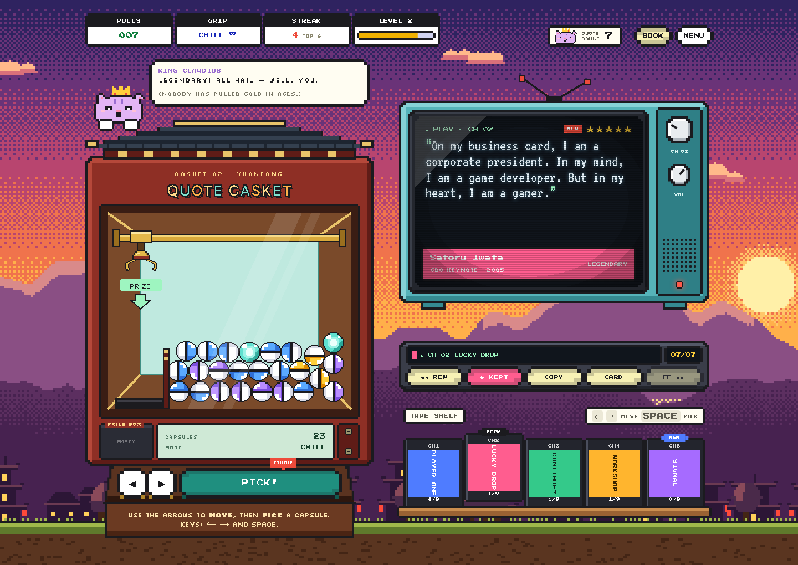

## Run it

```bash
pnpm install
pnpm dev --port 3002
```

Controls: `←` `→` (or `A` `D`) move the claw, `Space` drops it. Every control also has an on-screen button.

## How it plays

1. **Press START** on the TV.
2. **Heart of Repair.** The prize box is jammed with three pieces of scrap. Lift them out of the chute and the machine comes to life. This is the tutorial, and it only happens once.
3. **Grab a capsule.** Blue is common, purple is rare, gold is legendary. The capsule drops into the prize box, the TV cuts to static, the capsule cracks open on a sunburst, and the quote types out with its author and source.
4. **Collect.** Each tape (channel) holds nine quotes in three sets of three. Finishing a set pays out XP and a set-complete screen.

Other things to find:

- **Tape shelf.** Five tapes, five themes. Clicking one, or turning the CH dial on the TV, loads a different casket in a different place.
- **Orbs.** Two teal orbs ride in every load. Drop one in the prize box for a life back in Arcade mode, or bonus XP in Chill.
- **VCR deck.** REW and FF step through everything that has aired. KEEP favourites a quote, COPY puts it on the clipboard, CARD saves a 1080×1080 postcard PNG.
- **Quote book.** Every quote collected, with a stat card per quote and a quest log.
- **Arcade mode** (MENU). Aim matters, a slip costs one of nine lives, and running out ends the game.
- **Service hatch.** The panel with two screws on the cabinet opens the inside of the machine: a grip-strength dial, and a capsule you are told not to take.

## Five caskets

Every tape plays in its own casket, with its own backdrop.

| Channel | Casket | Backdrop |
| --- | --- | --- |
| 01 Player One | Arcade — the cream cabinet from the Figma file | Clear afternoon, snow-capped mountains, a small town |
| 02 Lucky Drop | Xuanfang — red lacquer, jade glass, brass claw, tiled roof | Sunset over pagoda rooftops with lit lanterns |
| 03 Continue? | Mint — green cabinet, pink rail | First light over green hills |
| 04 Workshop | Workshop — plywood, steel rail, orange claw | Golden hour |
| 05 Signal | Night Shift — dark cabinet, neon rail | Stars, a crescent moon, transmitter towers |

| | |
| --- | --- |
| 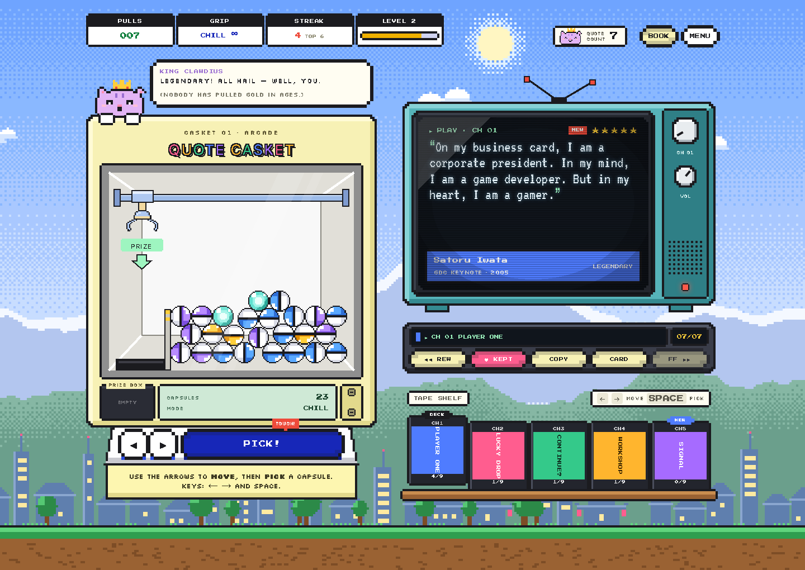 | 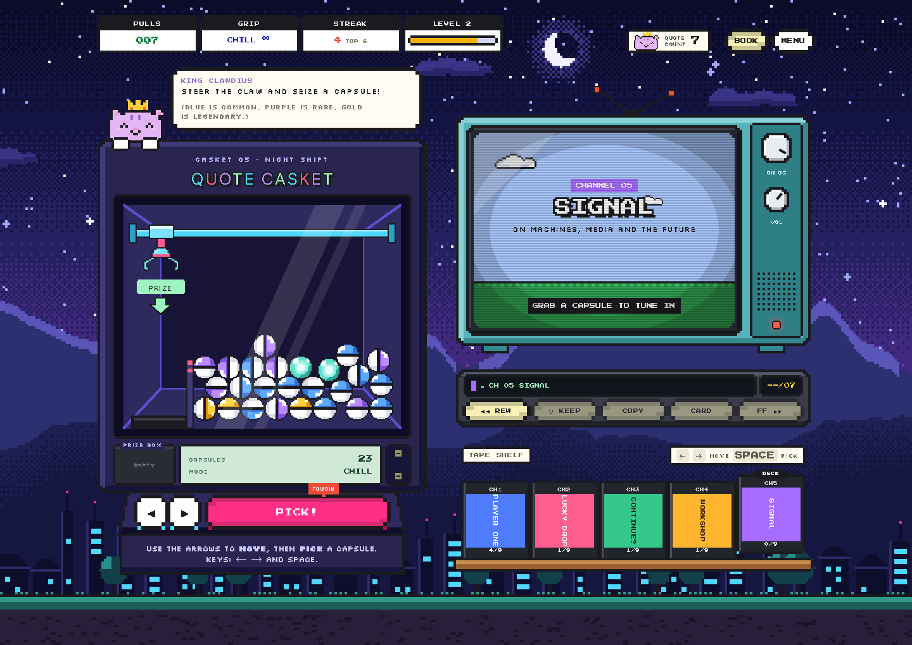 |
| 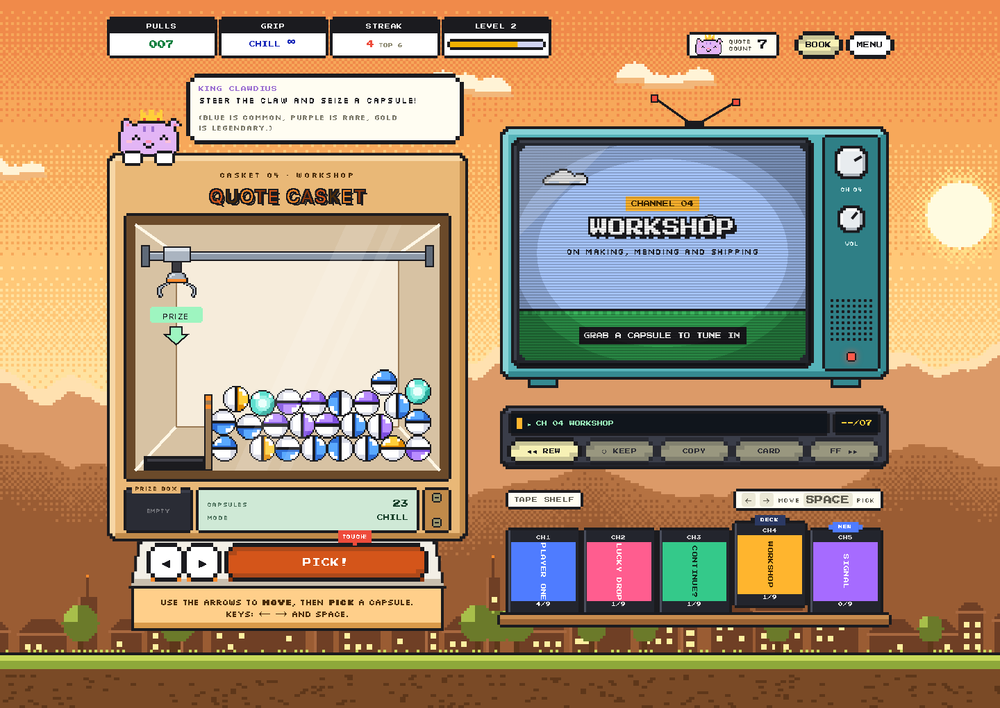 | 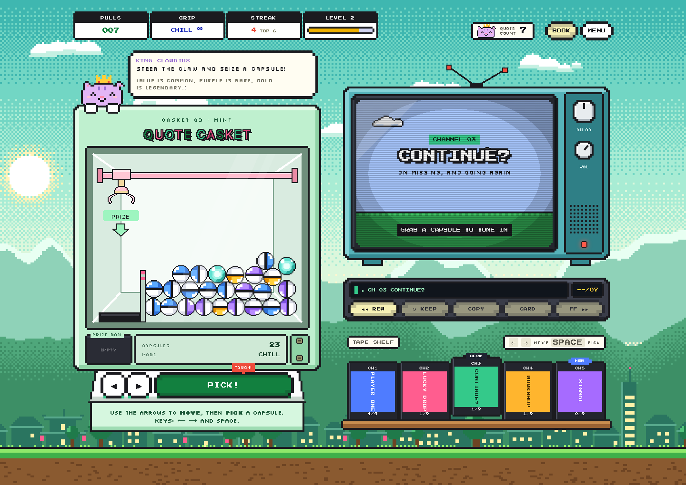 |

The Xuanfang casket is modelled on the Auto Casket in Wuthering Waves 3.5: a jade-glass box framed by red lacquered pillars, with a brass claw and a warm wooden interior. The orbs come from the same place, where grabbing one extends the timer.

## The backdrop

The scenery is generated in code, not drawn or downloaded. `src/components/backdrop.tsx` paints a canvas at a quarter of the screen's resolution and scales it up by exactly 4, so every pixel is square and lines up with the UI's own 4px grid. Each scene is a palette plus a seed:

- a sky that steps through four to six colours with ordered (Bayer) dithering between them
- a sun or moon with a dithered halo, and stars at night
- pale far mountains with lit caps and haze at the foot
- darker mid hills
- a town skyline built building by building from a weighted mix of houses, pagodas and towers, with lit windows
- trees, grass and speckled soil

Far layers are kept low-contrast so the cabinet stays the loudest thing on screen. Clouds creep one pixel at a time; nothing else moves, and nothing moves at all under reduced motion.

## The quotes

45 real quotes from real people, chosen to fit the machine rather than pulled from a general list: games and play, luck and taking the shot, missing and going again, making and mending, machines and broadcast. Each one carries its source and year so it can be checked. Where the wording is widely repeated but the original source is uncertain, the card says `attrib.` instead of naming one.

## Where the look comes from

| In the app | From |
| --- | --- |
| Cream cabinet, grey bevelled glass, blue rail and claw, tapered white deck, blue PICK bar | Figma, Mini Games — claw machine frame |
| Teal TV with antenna, two dials and a speaker grille | Figma, Mini Games — Retro Television |
| Tape shelf under the screen | Figma, Mini Games — game page with VHS shelf |
| Sunburst behind the opening capsule | Figma, Daily Treats — mystery box |
| Nine hearts, black-header HUD cells, GAME OVER card, "press START" | Figma, Daily Treats — streak cards and 8-bit screens |
| Quote-count pill with the mascot | Figma, quest pages — treat count |
| Podium cards on set complete, white card over a black panel with a mint button | Figma, Quest with rewards — reward cards |
| Stat card for each quote | The Wuthering Waves character screen saved in the Figma |
| Xuanfang casket, orbs, jammed prize box | Wuthering Waves 3.5 — Auto Casket and the Heart of Repair quest |
| Layered, dithered backdrop at one fixed pixel scale | Common pixel-art parallax practice: few layers, pale far layers, whole-number scaling |

King Clawdius, the mascot, is an original sprite. The Figma's own mascot was not copied.

## 8bitcn components used

Button, Badge, Alert, Dialog, Sheet, Tabs, Scroll Area, Item, Slider, Switch, Label, Kbd, Tooltip, Toast, XP Bar, Enemy Health Display (the jam's boss bar), Accordion and Card, plus two blocks: Quest Log and Difficulty Select. Both blocks were given small extra props (`title`, `options`, `labels`).

## Scorecard

Five criteria, 0–2 each. Scored from screenshots of the running app and from scripted play-throughs, not from the source.

| Criterion | First render | Round 1 | Round 2 | Final |
| --- | --- | --- | --- | --- |
| Matches the references | 1 | 1.5 | 2 | 2 |
| Stays on the pixel grid | 1 | 1.5 | 2 | 2 |
| Core loop works | 1 | 2 | 2 | 2 |
| Game systems work | 1 | 1.5 | 1.5 | 2 |
| Polish and responsiveness | 1 | 1.5 | 1.5 | 2 |
| **Total** | **5** | **8** | **9** | **10** |

What changed between rounds:

- **Round 1.** Fuller capsule pile. Tape shelf no longer overlaps its label. Marquee letters spaced. A tap now moves the claw a fixed step. The claw can reach scrap next to the chute post. Fixed scrap reappearing after a reload on a repaired machine. Fixed REW being dead after a tape change.
- **Round 2.** TV dials redrawn as pixel shapes. Tapered deck with a yellow base. Overlays dim with a dither instead of a blur. Glows banded instead of blended. Book entries and toasts squared off. Quote text sized to the screen so the longest quote fits a 375px phone. Simulation refactored so lint passes clean.
- **Final.** Generated backdrop per channel. Five caskets, including the Xuanfang one. Orbs. The claw now stops only on things it can close around, so a neighbour never blocks a capsule that is lined up, and a capsule can no longer be left flagged as held. A guard above the chute post means only something the claw drops can enter the prize box; before this, a full pile could spill a capsule over the post and award a quote nobody grabbed. Copy falls back to the older selection-based method when the Clipboard API is refused.

How the last two points were closed:

- **Copy.** Clicked COPY with the clipboard API stubbed: it received the exact quote and author and the app reported success. Clicked again with the API refusing: the fallback copied the same text. Stubbed so the test did not overwrite a real clipboard.
- **Postcard.** Clicked CARD with the download stubbed: a `quote-casket-p6.png` blob link was triggered and the app reported it saved. The image itself was rendered and inspected separately.
- **Sound.** Measured at the audio output after a real click: the reveal jingle peaked at 0.119 with the audio context running. This shows sound is produced; nobody listened to how it sounds.
- **Phone scroll.** At 375px, scrolled down to the machine, won a capsule, and the page scrolled the TV back to 16px from the top with the quote on it.
- **Soak.** 20 grabs in a row, each aimed at the topmost thing in the pile: 20 delivered (17 capsules, 3 orbs), sets completing along the way, nothing left stuck.
- **Idle.** 50 seconds of simulated idle time with a full pile: nothing entered the chute on its own. On a jammed machine, a capsule dropped on the scrap is thrown back onto the pile and the mascot says why.

## Checks

- `pnpm exec tsc --noEmit` — clean
- `pnpm exec eslint src` — clean
- `pnpm build` — passes
- No horizontal overflow at 375px or 1440px
- Browser console clean on a fresh tab

## Notes for development

`?demo=quote`, `reveal`, `over`, `book`, `victory`, `menu`, `hatch`, `ident` or `jam` opens the page in that state with a seeded save, and `&tape=play|luck|grit|make|signal` picks the casket. `window.__casket.tick(n)` steps the claw simulation by hand, which is needed when the tab is in the background and gets no animation frames. Both exist only in development builds.
